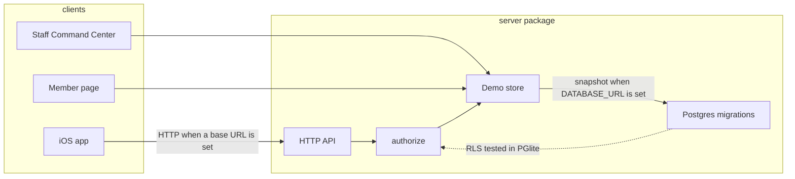

# Architecture

The Command Center, the member page, and the HTTP API share `ChurchStore`. With `DATABASE_URL` or `POSTGRES_URL`, each request loads and saves that store in Postgres (`demo_runtime`). Without it, the process keeps one in-memory copy, which is what CI uses. The iPhone app calls the API when `-apiBaseURL` or `API_BASE_URL` is set and otherwise shows a labeled on-device sample.

## iOS modules

`ios/Packages/OneHopeKit` is one Swift package with a product per tab plus Core and Design. Tabs do not import each other. The app target composes them. Core has no SwiftUI. Design has color, type, photos, and haptics.

View state is a small `@State` or `@Observable` model. Intents are button actions. We did not add The Composable Architecture; see the ADR.

Strict concurrency is on for the app target (`SWIFT_STRICT_CONCURRENCY = complete`) and warnings are errors. There are no force-unwraps in the Swift sources.

## Web

Next.js App Router, server components, server actions. Request bodies that hit the HTTP API are parsed with Zod. The Command Center calls the store in process, which is the same object the API uses. No `any`.

## Data

`server/migrations/0001_init.sql` is the RLS schema. `0002_retention.sql` adds retention and sync cursor tables. `0003_demo_runtime.sql` stores the labeled demo snapshot. `migrate()` records versions and does not reapply them. `server/scripts/generate-table-types.mjs --check` fails if `server/src/generated/tables.ts` drifts. `server/scripts/seed.ts` applies migrations and the labeled demo when a database URL is present.

Sync jobs take an idempotency key, retry, and skip a key that already succeeded. The runner is in memory. The `sync_cursors` table is the shape a Postgres runner would use. It is not connected yet.

## Performance

Targets, not device-lab measurements: Command Center first view under a second on a warm server, iOS cold launch to the first tab under two seconds on a recent iPhone, lists virtualized by SwiftUI and by HTML tables that stay on one screen of sample rows. There is no benchmark harness in CI.
